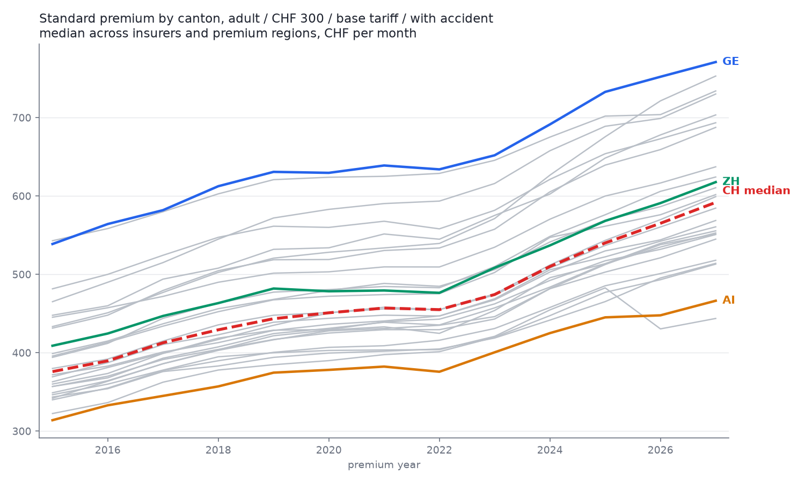
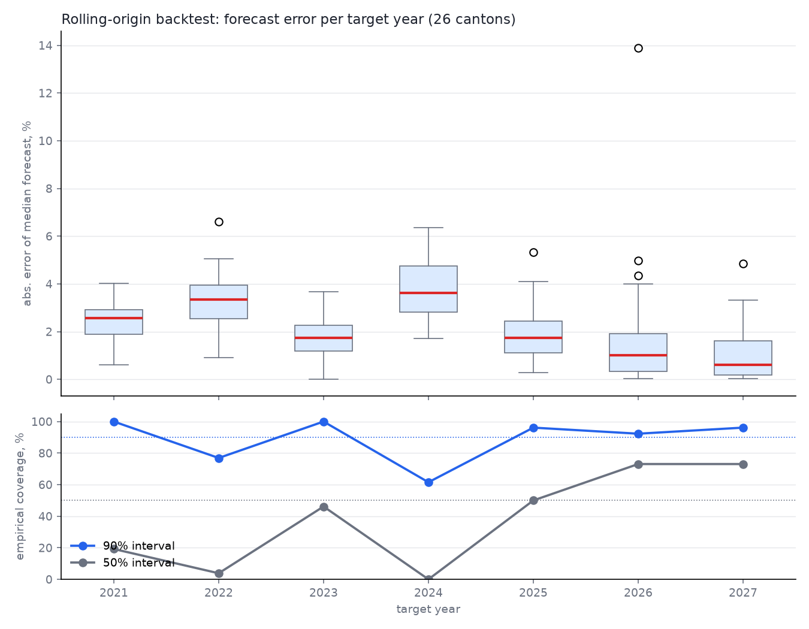
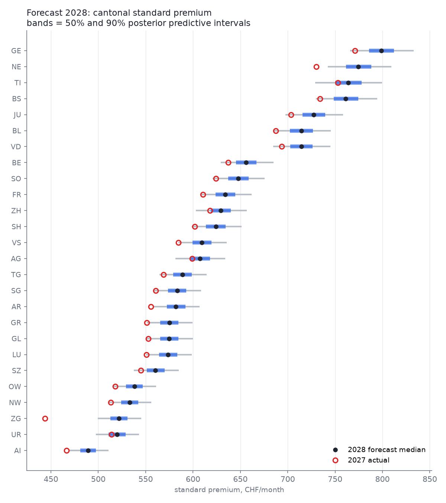

# premium-ch

**Bayesian forecasting of Swiss health insurance premiums (KVG/OKP) on official BAG open data — with a verified out-of-sample track record and a falsifiable 2028 prediction.**




*Standard premium (adult, CHF 300 franchise, base tariff, with accident cover) per canton, 2015-2027. Grey: all 26 cantons; highlighted: the most expensive (GE), the cheapest (AI), the largest (ZH) and the national median. Note Zug's dive in 2026 — a policy intervention, not noise (see Highlights).*

## Highlights

| Result | Value |
|---|---|
| Out-of-sample forecasts scored (rolling-origin backtest, 2021-2027) | **181** |
| Median absolute forecast error | **2.11%** |
| Empirical coverage of the 90% predictive interval | **89%** |
| Zug 2026 policy intervention, causal premium effect | **-12.1%** (94% HDI [-13.6%, -10.5%]) |
| Zug 2027 forecast with intervention encoded vs actual | **445 vs 444 CHF (0.2% error)** |
| Falsifiable headline: Zug 2028 snap-back forecast | **522 CHF/month (+17.6%)** |
| CH median standard premium 2015 → 2027 | **376 → 592 CHF (+57.4%, 3.85%/yr)** |
| MCMC diagnostics (final model) | r_hat ≤ 1.007, ESS ≥ 967, 0 divergences |

## Table of contents

- [What this is](#what-this-is)
- [Data](#data)
- [Pipeline](#pipeline)
- [The model](#the-model)
- [The Zug natural experiment](#the-zug-natural-experiment)
- [Backtest: the track record](#backtest-the-track-record)
- [2028 forecast](#2028-forecast)
- [Reproducing](#reproducing)
- [Limitations](#limitations)
- [Roadmap](#roadmap)
- [License and data terms](#license-and-data-terms)

## What this is

Every September, the Swiss Federal Office of Public Health (BAG) publishes next year's approved health insurance premiums for all insurers, cantons, regions, age groups, franchises and insurance models. This project turns 13 years of that data (2015-2027, ~3.26M premium records) into a hierarchical Bayesian forecasting model — and, unlike most premium commentary, scores itself: every forecast is backtested against premiums the model had not seen, and the headline 2028 prediction is published before the data exists.

## Data

Source: the official BAG premium dataset (priminfo) on [opendata.swiss](https://opendata.swiss/en/dataset/health-insurance-premiums), resolved at runtime through the CKAN API — no hardcoded file URLs.

- 16 archive years downloaded (2011-2026) plus the current 2027 files; **2015-2027 harmonized** into one parquet (the 2011-2014 coded-schema era is a planned extension)
- Schema drift handled explicitly: a strict column contract that fails loudly on anything unmapped, per-file encoding/separator sniffing (2015 is comma-separated, the rest semicolon; cp1252 and UTF-8 both occur)
- The 2027 files introduced a full code-system rename (`AKL-ERW`→`AKA_03_ERW`, `FRAST1`→`FRASTU_01`, `TAR-BASE`→`BASE`, ...); mappings were established by count identities, not guesswork
- 2024 ships two validity periods (a mid-year premium adjustment); every year uses the valid-from-January-1 snapshot for a consistent definition
- "Standard premium" filter proven from the data's own base flags: `isBaseP=1 & isBaseF=1 & adult & with accident` — the politically quoted Standardprämie

## Pipeline

```
pipeline/
  s00_download.py      CKAN-driven download, sha256 manifest, idempotent
  s01_audit.py         coverage + schema audit per year (report-first, no guessing)
  s02_harmonize.py     2015-2027 -> one tidy parquet (3.26M rows), validation gates
  s03_eda.py           standard premium extraction, cantonal medians, figures f01-f04
  s04_model_trend.py   hierarchical Bayesian model + 2028 forecast (f05)
  s05_backtest.py      rolling-origin backtest, 7 origins (f06)
```

Everything runs on CPU (a 20-core host does the full backtest in ~8 minutes). The model is small; benchmarking in a sibling project showed GPU overhead dominates at this size, so GPU is reserved for a future batched full-granularity model.

## The model

Log median standard premium per canton and year:

```
y[c,t] ~ StudentT(nu, mu[c,t], sigma)
mu[c,t] = a[c] + b[c]*(t - t0) + f[t] + delta_zg * I[c=ZG, t in {2026, 2027}]
```

- `a[c]`, `b[c]`: canton intercepts and growth slopes, partially pooled (non-centered parameterization — the centered version showed the classic funnel: r_hat 1.012, ESS 321; non-centered: r_hat 1.007, ESS 967, and ~40% faster)
- `f[t]`: national year effect as a random walk — absorbs the common shocks (the 2022 premium freeze, the 2024 spike) so they don't contaminate canton slopes
- `delta_zg`: the Zug 2026/2027 policy intervention as an explicit dummy
- Student-t likelihood for robustness to undocumented shocks
- NUTS, 4 chains, full diagnostics written to `data/processed/posterior_summary.csv`

## The Zug natural experiment

For 2026 and 2027 the canton of Zug covers 99% of inpatient hospital costs from cantonal surpluses (~220M CHF), and insurers were required to price this in — a clean natural experiment on premium formation, announced to end in 2028.

- The model's causal estimate: the intervention cut Zug standard premiums by **12.1%** (94% HDI [10.5%, 13.6%]), consistent with the officially reported -14.7% on the all-models mean premium
- In the backtest, a data-only model (training window ending 2025) missed Zug 2026 by **13.9%** — its single worst forecast. With the intervention encoded, the Zug 2027 forecast landed within **0.2%** — its single best. One published policy fact, worst-to-best.
- Because the intervention is legislated to expire, the model predicts a **snap-back**: see [2028 forecast](#2028-forecast)

## Backtest: the track record



*Top: absolute error of the median forecast per target year, 26 cantons each. Bottom: empirical coverage of the 50% and 90% predictive intervals.*

Train on years ≤ T, forecast every canton's year T+1, score against the actual — repeated for seven origins (targets 2021-2027). Headline: **median error 2.11%, 90%-interval coverage 89% over 181 forecasts** (Zug rows that used the intervention dummy excluded from the headline to keep it honest).

The backtest also documents what the model *cannot* do, in `docs/research_findings.md`: it lags regime shifts by one year (over-predicted the 2022 freeze, under-predicted the 2024 spike — 50% coverage hit literally 0% that year), and its errors are correlated across cantons, because the dominant uncertainty is the shared national year effect. A cantonal forecast from this model is one national bet plus 26 small ones.

## 2028 forecast



*2028 forecast per canton (50% and 90% predictive intervals) against 2027 actuals. Zug's 2027 actual sits far left of its own forecast band — the predicted end-of-intervention snap-back.*

The one number to check in September 2027, when BAG publishes the 2028 premiums:

> **Zug 2028 standard premium: 522 CHF/month, +17.6% vs 2027** — the intervention expires and the model says premiums revert to trend. No trend-extrapolation model produces this number.

Caveat, stated upfront: Zug's own government expects 2028 to also carry the cost growth accumulated during the subsidized years, so this trend-level forecast is arguably a floor.

## Reproducing

```bash
conda create -n premium-ch python=3.12 -y
conda activate premium-ch
conda install -c conda-forge numpy pandas pyarrow requests openpyxl xlrd \
    tabulate matplotlib numpyro arviz h5netcdf -y

python pipeline/s00_download.py     # ~300 MB from opendata.swiss
python pipeline/s01_audit.py
python pipeline/s02_harmonize.py
python pipeline/s03_eda.py
python pipeline/s04_model_trend.py  # ~2 min CPU
python pipeline/s05_backtest.py     # ~8 min CPU
```

Paths are configured at the top of each script.

## Limitations

- Cantonal aggregate is the **unweighted median** across insurers and premium regions; enrollment-weighted means need insured counts that BAG publishes for the current year only
- The standard premium (base tariff, CHF 300) is not the "mittlere Prämie" quoted in the news (all models, all franchises, enrollment-weighted) — growth rates track closely, levels differ by construction
- No cost-driver decomposition yet — premiums are modeled from premiums
- `C_ID` special codes beyond the 26 cantons (`CH`, `ZE`, `ZR`) are retained in the data but excluded from the cantonal model

## Roadmap

- **v1.1** — the 2011-2014 coded-schema era (4 more years of history); enrollment-weighted aggregates; Ticino-specific trend handling (worst canton in 3 of 7 backtest years)
- **v1.2** — cost-driver layer from BAG KVG statistics; spatial (BYM2) model on premium regions; batched full-granularity GPU model (insurer x region x age x franchise)
- **September 2027** — score the 2028 forecast against reality and publish the result, either way

## License and data terms

Code: MIT. Data: Bundesamt für Gesundheit (BAG), [opendata.swiss terms (attribution)](https://opendata.swiss/terms-of-use#terms_by) — this project is not affiliated with or endorsed by BAG.
