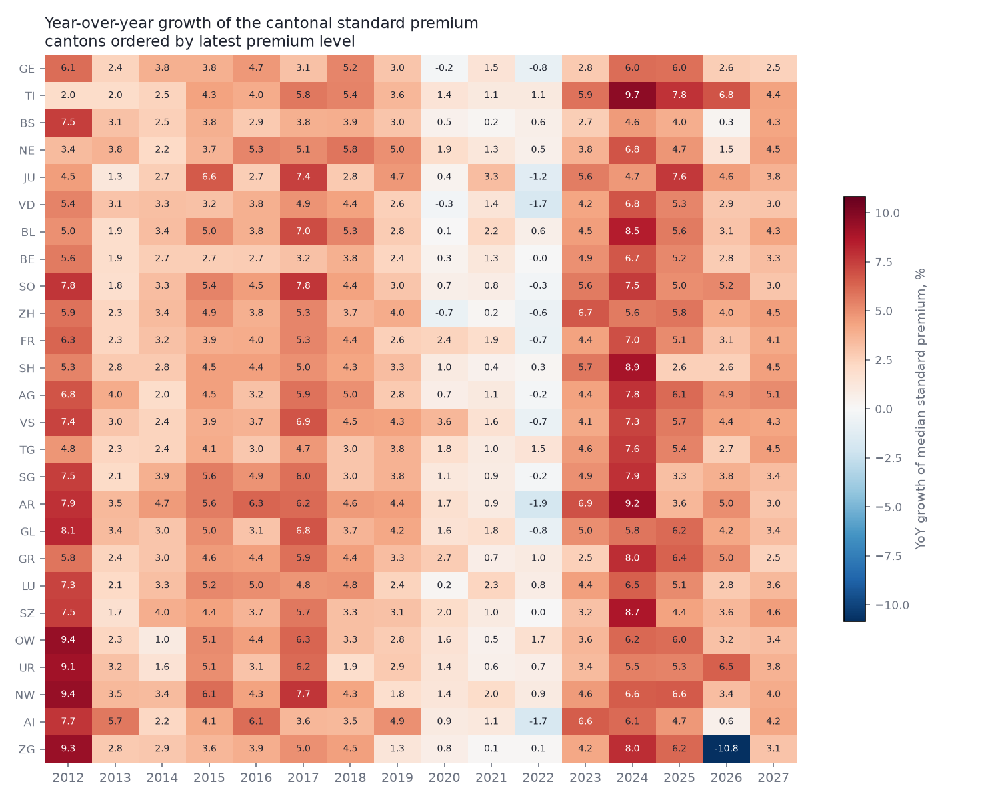
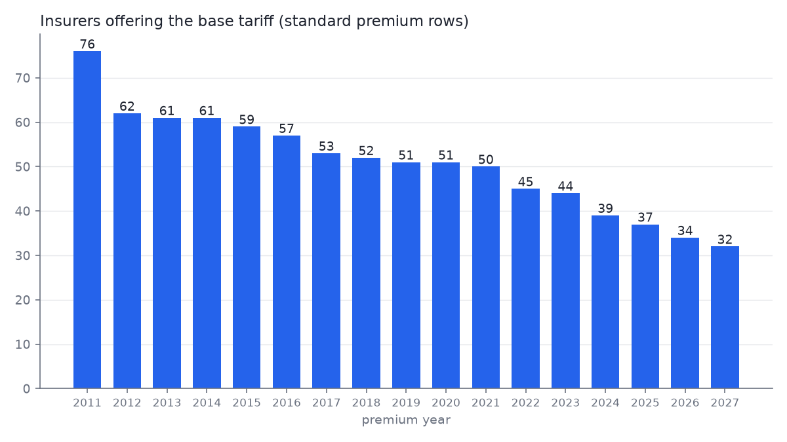
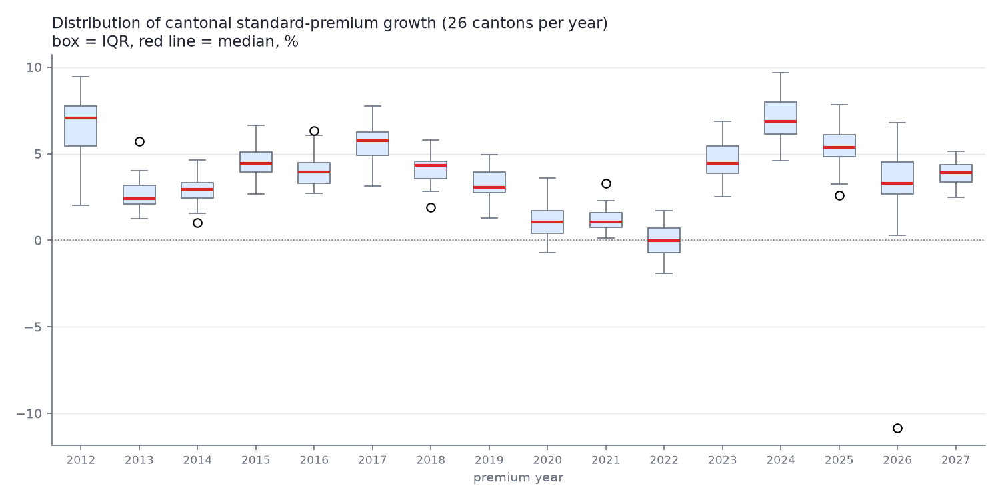

# premium-ch

**Bayesian forecasting of Swiss health insurance premiums (KVG/OKP) on official BAG open data — 17 years of history, a verified out-of-sample track record, and a falsifiable 2028 prediction.**


*Standard premium (adult, CHF 300 franchise, base tariff, with accident cover) per canton. Grey: all 26 cantons; highlighted: the most expensive (GE), the cheapest (AI), the largest (ZH) and the national median. Note Zug's dive in 2026 — a policy intervention, not noise (see Highlights).*

## Highlights

| Result | Value |
|---|---|
| Premium records harmonized (2011-2027, two schema eras) | **4.42M** |
| Out-of-sample forecasts scored (rolling-origin backtest, targets 2017-2027) | **285** |
| Median absolute forecast error | **1.75%** |
| Empirical coverage of the 90% predictive interval | **86%** |
| Zug 2026/27 policy intervention, causal premium effect | **-12.1%** (94% HDI [-13.7%, -10.4%]) |
| Zug 2027 forecast with intervention encoded vs actual | **445 vs 444 CHF (0.3% error)** |
| Falsifiable headline: Zug 2028 snap-back forecast | **522 CHF/month (+17.7%, 90% interval 501-545)** |
| CH median standard premium 2011 -> 2027 | **323 -> 592 CHF (+83.1%, 3.85%/yr)** |
| MCMC diagnostics (final model, 442 obs) | r_hat <= 1.003, ESS >= 937, 0 divergences |

## Table of contents

- [What this is](#what-this-is)
- [Data](#data)
- [Pipeline](#pipeline)
- [Exploratory results](#exploratory-results)
- [The model](#the-model)
- [The Zug natural experiment](#the-zug-natural-experiment)
- [Backtest: the track record](#backtest-the-track-record)
- [2028 forecast](#2028-forecast)
- [Reproducing](#reproducing)
- [Limitations](#limitations)
- [Roadmap](#roadmap)
- [License and data terms](#license-and-data-terms)

## What this is

Every September, the Swiss Federal Office of Public Health (BAG) publishes next year's approved health insurance premiums for all insurers, cantons, regions, age groups, franchises and insurance models. This project turns 17 years of that data (2011-2027, 4.42M premium records) into a hierarchical Bayesian forecasting model — and, unlike most premium commentary, scores itself: every forecast is backtested against premiums the model had not seen, and the headline 2028 prediction is published before the data exists.

## Data

Source: the official BAG premium dataset (priminfo) on [opendata.swiss](https://opendata.swiss/en/dataset/health-insurance-premiums), resolved at runtime through the CKAN API — no hardcoded file URLs.

The dataset spans **two schema eras**, both harmonized into one tidy parquet:

- **2015-2027**: 17 self-describing German columns. Handled drift: a column rename in 2015/16, a full code-system rename in 2027 (`AKL-ERW`→`AKA_03_ERW`, `FRAST1`→`FRASTU_01`, `TAR-BASE`→`BASE`, ...) with mappings established by count identities; 2024 ships two validity periods (a mid-year adjustment) and every year uses the valid-from-January-1 snapshot.
- **2011-2014**: a 22-column coded schema (`G_ID`/`C_ID`/`M_ID`/`VAR_ID`/...), decoded against the official per-year dictionary `Doku_PraemienDaten.txt` shipped inside each archive. The decoding is **proven end to end** by an insurer bridge across the schema break: insurer numbering is continuous (zero-padding aside), and the implied 2014->2015 standard-premium growth per canton comes out at a plausible median 4.46% (range 2.7-6.6%) — a built-in validation gate, not a one-off check.
- Format drift handled explicitly: per-file encoding and separator sniffing (comma vs semicolon, cp1252 vs UTF-8 — including a cp1252 file whose first umlaut appears 27 KB past an ASCII header), and a strict column contract that fails loudly on anything unmapped.
- "Standard premium" filter proven from the data's own base flags: `isBaseP & isBaseF & adult & with accident` — the politically quoted Standardprämie, applied era-blind.

## Pipeline

```
pipeline/
  s00_download.py      CKAN-driven download, sha256 manifest, idempotent
  s01_audit.py         coverage + schema audit per year (report-first, no guessing)
  s02_harmonize.py     both eras -> one tidy parquet (4.42M rows), validation gates
  s03_eda.py           standard premium extraction, cantonal medians, figures f01-f04
  s04_model_trend.py   hierarchical Bayesian model + 2028 forecast (f05)
  s05_backtest.py      rolling-origin backtest, 11 origins (f06)
```

Everything runs on CPU (a 20-core host does the full backtest in ~15 minutes). The model is small; benchmarking in a sibling project showed GPU overhead dominates at this size, so GPU is reserved for a future batched full-granularity model.

## Exploratory results



*Year-over-year growth of the cantonal standard premium. The common shocks are vertical stripes: the 2020-2022 plateau (2022 median: -0.05%, the reserve-reduction year), the 2024 spike (+6.9% median), and Zug's -10.8% in 2026 — the policy intervention.*



*Insurers offering the base tariff, per year — a monotone consolidation across the whole period (59 in 2015, 32 in 2027), with no single-year discontinuity.*



*Distribution of the 26 cantonal growth rates per year. The box width shows how synchronized the cantons are — the common national shock dominates.*

## The model

Log median standard premium per canton and year, NumPyro/NUTS:

```
y[c,t] ~ StudentT(nu, mu[c,t], sigma)
mu[c,t] = a[c] + b[c]*(t - t0) + f[t] + delta_zg * I[c=ZG, t in {2026, 2027}]
```

- `a[c]`, `b[c]`: canton intercepts and canton-specific log-slopes, partially pooled (non-centered parameterization — the centered version showed the classic funnel: r_hat 1.012, ESS 321; non-centered: r_hat 1.003, ESS 937, and ~40% faster)
- `f[t]`: national year effect as a random walk — absorbs the common shocks (the 2020-2022 plateau, the 2024 spike) so they don't contaminate canton slopes
- `delta_zg`: the Zug 2026/2027 policy intervention as an explicit dummy
- Student-t likelihood for robustness to undocumented shocks
- 442 observations (26 cantons x 17 years), NUTS 4 chains, full diagnostics written to `data/processed/posterior_summary.csv`

## The Zug natural experiment

For 2026 and 2027 the canton of Zug covers 99% of inpatient hospital costs from cantonal surpluses (~220M CHF), and insurers were required to price this in — a clean natural experiment on premium formation, announced to end in 2028.

- The model's causal estimate: the intervention cut Zug standard premiums by **12.1%** (94% HDI [10.4%, 13.7%]), consistent with the officially reported -14.7% on the all-models mean premium
- In the backtest, a data-only model (training window ending 2025) missed Zug 2026 by **14.0%** — its single worst forecast. With the intervention encoded, the Zug 2027 forecast landed within **0.3%** — its single best. One published policy fact, worst-to-best.
- Because the intervention is legislated to expire, the model predicts a **snap-back**: see [2028 forecast](#2028-forecast)

## Backtest: the track record


*Top: absolute error of the median forecast per target year, 26 cantons each. Bottom: empirical coverage of the 50% and 90% predictive intervals.*

Train on years <= T, forecast every canton's year T+1, score against the actual — repeated for eleven origins (targets 2017-2027). Headline: **median error 1.75%, 90%-interval coverage 86% over 285 forecasts** (Zug rows that used the intervention dummy excluded from the headline to keep it honest).

The structure is as instructive as the headline. In calm years (targets 2017-2019, 2023, 2025-2027) the model runs at **0.8-1.5% median error with 88-100% coverage**. Nearly all the damage concentrates in three documented regime shifts it could not foresee: the 2020 pandemic-era plateau, the 2022 reserve-reduction freeze, and the 2024 spike — each missed by one year, the structural limit of any trend model (details and all misses in `docs/research_findings.md`). Errors are also correlated across cantons, because the dominant uncertainty is the shared national year effect: a cantonal forecast from this model is one national bet plus 26 small ones.

## 2028 forecast


*2028 forecast per canton (50% and 90% predictive intervals) against 2027 actuals. Zug's 2027 actual sits far left of its own forecast band — the predicted end-of-intervention snap-back.*

The one number to check in September 2027, when BAG publishes the 2028 premiums:

> **Zug 2028 standard premium: 522 CHF/month (90% interval 501-545), +17.7% vs 2027** — the intervention expires and the model says premiums revert to trend. No trend-extrapolation model produces this number. Notably, this forecast is invariant to the training window: 13 or 17 years of history give the same answer to within 1 CHF.

Caveats, stated upfront: Zug's own government expects 2028 to also carry the cost growth accumulated during the subsidized years, so this trend-level forecast is arguably a floor. And the TI 2028 forecast (-2.6%) should not be trusted — Ticino is the model's documented weak spot (actuals persistently above the fitted trend), and a premium decline there is trend-reversion artifact, not prediction.

## Reproducing

```bash
conda create -n premium-ch python=3.12 -y
conda activate premium-ch
conda install -c conda-forge numpy pandas pyarrow requests openpyxl xlrd \
    tabulate matplotlib numpyro arviz h5netcdf -y

python pipeline/s00_download.py     # ~450 MB from opendata.swiss
python pipeline/s01_audit.py
python pipeline/s02_harmonize.py
python pipeline/s03_eda.py
python pipeline/s04_model_trend.py  # ~2 min CPU
python pipeline/s05_backtest.py     # ~15 min CPU
```

Paths are configured at the top of each script.

## Limitations

- Cantonal aggregate is the **unweighted median** across insurers and premium regions; enrollment-weighted means need insured counts that BAG publishes for the current year only
- The standard premium (base tariff, CHF 300) is not the "mittlere Prämie" quoted in the news (all models, all franchises, enrollment-weighted) — growth rates track closely, levels differ by construction
- No cost-driver decomposition yet — premiums are modeled from premiums
- Constant canton slopes understate Ticino's accelerating growth (worst-forecast canton in 3 of 11 backtest years, always under-predicted)
- `C_ID`/`Kanton` special codes beyond the 26 cantons (`CH`, `ZE`, `ZR`) are retained in the data but excluded from the cantonal model

## Roadmap

- **v1.1 (this release)** — the 2011-2014 coded-schema era decoded and validated (+4 years of history, backtest extended from 181 to 285 scored forecasts)
- **v1.2** — Ticino time-varying slope; enrollment-weighted aggregates; cost-driver layer from BAG KVG statistics; spatial (BYM2) model on premium regions; batched full-granularity GPU model (insurer x region x age x franchise)
- **September 2027** — score the 2028 forecast against reality and publish the result, either way

## License and data terms

Code: MIT. Data: Bundesamt für Gesundheit (BAG), [opendata.swiss terms (attribution)](https://opendata.swiss/terms-of-use#terms_by) — this project is not affiliated with or endorsed by BAG.
